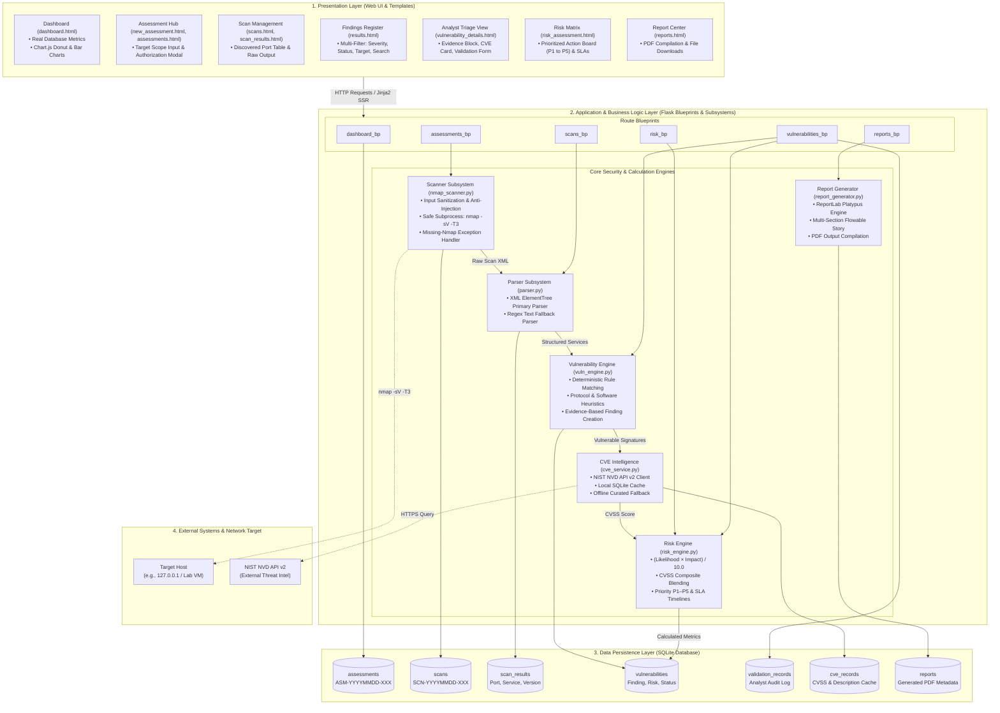
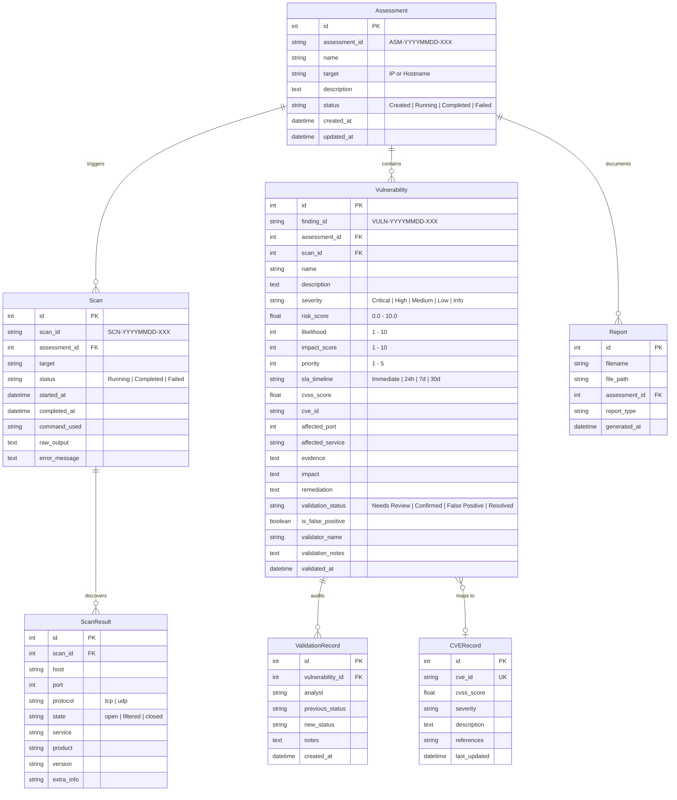
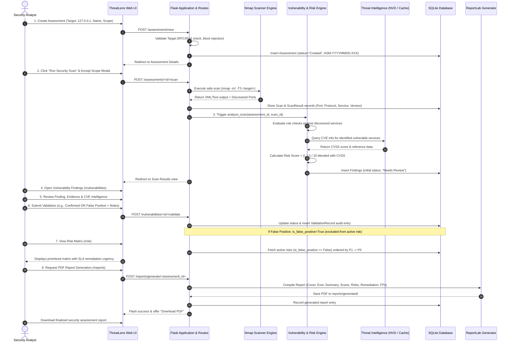

# 🛡️ ThreatLens: Comprehensive System Documentation & Technical Architecture

> **Project Title:** ThreatLens — Cybersecurity Vulnerability Assessment & Risk Management System  
> **Academic Context:** Final-Year B.E. Computer Science and Engineering Capstone Project  
> **Classification:** Defensive Cybersecurity / Vulnerability Management / Applied Security Engineering  
> **Technology Stack:** Python 3.10+, Flask, SQLite, SQLAlchemy, Nmap, ReportLab, Vanilla CSS, Chart.js  

---

## Table of Contents
1. [Executive Summary & What is ThreatLens?](#1-executive-summary--what-is-threatlens)
2. [Problem Statement & Objectives](#2-problem-statement--objectives)
3. [System Architecture & Design](#3-system-architecture--design)
4. [Database Entity-Relationship (ER) Architecture](#4-database-entity-relationship-er-architecture)
5. [Complete End-to-End Workflow & Life Cycle](#5-complete-end-to-end-workflow--life-cycle)
6. [Deep-Dive into System Subsystems](#6-deep-dive-into-system-subsystems)
   - 6.1 Safe Scanning Engine & Input Sanitization
   - 6.2 Structured Scanner Parser
   - 6.3 Rule-Based Vulnerability Analysis Engine
   - 6.4 Mathematical Risk Scoring & Prioritization
   - 6.5 CVE Threat Intelligence & Resilient Caching
   - 6.6 Manual Validation & False-Positive Management
   - 6.7 ReportLab PDF Compilation Engine
7. [Repository Structure & Codebase Guide](#7-repository-structure--codebase-guide)
8. [Demonstration & Execution Guide (Viva / Examiner Presentation)](#8-demonstration--execution-guide-viva--examiner-presentation)
9. [Ethical Safeguards, Boundaries & Limitations](#9-ethical-safeguards-boundaries--limitations)

---

## 1. Executive Summary & What is ThreatLens?

### 1.1 What is ThreatLens?
**ThreatLens** is an authorized, web-based vulnerability assessment and cybersecurity risk management platform. Unlike simple network scanner wrappers that merely dump raw command-line text, ThreatLens implements the complete professional vulnerability management lifecycle:

$$\text{Scope Definition} \longrightarrow \text{Service Discovery} \longrightarrow \text{Vulnerability Analysis} \longrightarrow \text{Risk Scoring} \longrightarrow \text{Analyst Triage} \longrightarrow \text{Remediation Tracking} \longrightarrow \text{Executive PDF Reporting}$$

It models the workflow of a modern **Security Operations Center (SOC)** or **Vulnerability Management Team**, providing:
1. **Controlled, authorized scanning:** Safe service discovery (`nmap -sV -T3`) with strict target input validation to prevent command injection.
2. **Honest, evidence-based vulnerability analysis:** Deterministic rules matching factual scanner findings (ports, services, versions). If an open port has no identifiable vulnerability, it remains an open service rather than being falsely flagged.
3. **Quantitative, explainable risk scoring:** Calculated using Likelihood, Impact, and CVSS benchmarks, categorizing issues into priorities P1 through P5 with explicit remediation SLAs.
4. **Analyst-in-the-loop manual validation:** Triage mechanism allowing security analysts to mark findings as *Needs Review*, *Confirmed*, *False Positive*, or *Resolved*, complete with audit trails. False positives are mathematically excluded from active risk metrics.
5. **Publication-grade PDF reports:** Multi-page executive and technical reports generated on demand using ReportLab.

---

## 2. Problem Statement & Objectives

### 2.1 The Problem
In real-world cybersecurity operations and enterprise environments:
- **Raw Scanner Noise:** Vulnerability scanners produce thousands of uncontextualized lines of text, overwhelming security analysts.
- **False-Positive Fatigue:** Many automated tools blindly label every open port as a vulnerability, leading to wasted remediation effort and missed critical risks.
- **Disconnect Between Detection and Remediation:** Network discovery tools rarely map findings directly to actionable fixes, business impact, and remediation timelines (SLAs).
- **Academic Simulation Gap:** Many student cybersecurity projects rely entirely on hardcoded or fabricated mock data, failing to demonstrate real parsing, persistence, triage workflows, or reporting.

### 2.2 Project Objectives
ThreatLens was engineered to achieve seven technical milestones:
1. **Safe Automation:** Automate service and version discovery against authorized lab targets without offensive exploitation or service degradation.
2. **Structured Persistence:** Parse raw XML scanner output into structured relational SQLite tables (`Scan`, `ScanResult`, `Vulnerability`).
3. **Explainable Risk Formulation:** Implement a transparent mathematical formula ($\text{Risk} = \frac{L \times I}{10.0}$) rather than arbitrary black-box scores.
4. **Resilient Threat Intelligence:** Query the NIST National Vulnerability Database (NVD API v2) with local database caching and an offline fallback dictionary.
5. **Auditable Validation:** Provide an analyst review system with timestamps, analyst identities, and justification notes.
6. **False-Positive Isolation:** Isolate false positives so they never artificially inflate active risk scores.
7. **Automated Document Synthesis:** Generate downloadable, formatted PDF security assessment reports.

---

## 3. System Architecture & Design

ThreatLens follows a modular, three-tier architectural design ensuring separation of concerns between presentation, business logic, and persistence.



```
+-----------------------------------------------------------------------------------+
|                              PRESENTATION LAYER (UI)                              |
|   - Modern Dark-Theme Cyber UI (Vanilla CSS Design System)                        |
|   - Responsive Layouts, Badges, Modals, Breadcrumbs, Data Tables                  |
|   - Chart.js 4.4 Visualizations (Severity Donut & Assessment Status Bar)         |
|   - Interactive Analyst Validation & Triage Forms                                 |
+-----------------------------------------------------------------------------------+
                                        |  HTTP / Jinja2 SSR
                                        v
+-----------------------------------------------------------------------------------+
|                        APPLICATION & BUSINESS LOGIC LAYER                         |
|                                                                                   |
|  +--------------------+  +---------------------+  +----------------------------+  |
|  | Flask Blueprints   |  | Target Validation   |  | Nmap Safe Subprocess       |  |
|  | - dashboard_bp     |  | - RFC Hostnames     |  | - Subprocess execution     |  |
|  | - assessments_bp   |  | - IPv4 Validation   |  | - -sV -T3 parameter lock   |  |
|  | - scans_bp         |  | - Injection Blocker |  | - Cross-platform PATH test |  |
|  | - vulnerabilities  |  +---------------------+  +----------------------------+  |
|  | - risk_bp          |                                                           |
|  | - reports_bp       |  +---------------------+  +----------------------------+  |
|  +--------------------+  | Parser Subsystem    |  | Rule-Based Vuln Engine     |  |
|                          | - XML Parser (ETree)|  | - Service Risk Rules       |  |
|                          | - Text Fallback     |  | - Insecure Protocol Rules  |  |
|                          +---------------------+  | - Version Signature Checks |  |
|                                                   +----------------------------+  |
|  +--------------------+  +---------------------+  +----------------------------+  |
|  | Risk Engine        |  | Threat Intelligence |  | ReportLab PDF Generator    |  |
|  | - L x I / 10.0     |  | - NIST NVD API v2   |  | - Flowable Story Builder   |  |
|  | - CVSS Blending    |  | - SQLite Caching    |  | - Custom Platypus Styles   |  |
|  | - P1-P5 SLA Mapping|  | - Offline Fallback  |  | - Multi-section Generator  |  |
|  +--------------------+  +---------------------+  +----------------------------+  |
+-----------------------------------------------------------------------------------+
                                        |  SQLAlchemy ORM
                                        v
+-----------------------------------------------------------------------------------+
|                              DATA PERSISTENCE LAYER                               |
|                            SQLite Database (database.db)                          |
|   [assessments]  <--->  [scans]  <--->  [scan_results]                            |
|         |                                                                         |
|         +-------------> [vulnerabilities] <---> [validation_records]              |
|                               |                                                   |
|                         [cve_records]           [reports]                         |
+-----------------------------------------------------------------------------------+
```

---

## 4. Database Entity-Relationship (ER) Architecture

The database is built on SQLite using Flask-SQLAlchemy. It maintains referential integrity across the entire assessment lifecycle:



---

## 5. Complete End-to-End Workflow & Life Cycle

The operational workflow follows an 8-stage sequence:



---

## 6. Deep-Dive into System Subsystems

### 6.1 Safe Scanning Engine & Input Sanitization
*File:* `scanner/nmap_scanner.py`

#### Target Validation & Injection Prevention
Network vulnerability scanners often suffer from parameter injection vulnerabilities if user input is passed directly to a shell. ThreatLens enforces strict target validation:
- Rejects shell metacharacters: `;`, `&`, `|`, `` ` ``, `$`, `\n`, `\r`, `>`, `<`, `(`, `)`.
- Rejects flag injection: strings starting with `-` (e.g., `--script`, `-oN`).
- Accepts only valid IPv4 addresses, `localhost`, and RFC 1123 compliant domain names.

#### Controlled Scan Profile
ThreatLens explicitly restricts scanning parameters to non-destructive service discovery:
```bash
nmap -sV -T3 -oX <temp_xml_path> <target>
```
- `-sV`: Standard version detection probe.
- `-T3`: Normal timing (polite to network equipment; prevents denial of service).
- No intrusive scripts (`--script vuln`), no brute-forcing, and no exploitation payloads are ever used.

#### Graceful Missing-Nmap Handling
If Nmap is not installed or missing from the system `PATH`:
- The application catches `FileNotFoundError` via Python's `subprocess`.
- Instead of crashing with a Python 500 error, it returns:
  > *"Nmap is not installed or could not be found. Please install Nmap and ensure it is available in the system PATH."*
- Marks the scan as `Failed` in SQLite with diagnostic notes and displays troubleshooting advice.

---

### 6.2 Structured Scanner Parser
*File:* `scanner/parser.py`

The parser ingests Nmap's output into normalized Python dictionaries:
- **Primary Parser (`parse_nmap_xml`):** Uses Python's native `xml.etree.ElementTree` to parse Nmap's structured `-oX` output. It extracts:
  - Host address and state
  - Port number and protocol (`tcp`/`udp`)
  - Port state (`open`, `filtered`, `closed`)
  - Service identification (`http`, `ftp`, `ssh`, `telnet`, `mysql`, etc.)
  - Software product name and exact version string
- **Secondary Fallback Parser (`parse_nmap_text`):** If XML parsing fails or text output is provided, a regex-based parser extracts tabular columns (`PORT`, `STATE`, `SERVICE`, `VERSION`).

---

### 6.3 Rule-Based Vulnerability Analysis Engine
*File:* `scanner/vuln_engine.py`

ThreatLens does not invent fictional vulnerabilities. It evaluates actual discovered services against deterministic security heuristics:

| Detection Rule | Trigger Condition | Severity | Risk Score | Priority & SLA | CVE Mapped |
|---|---|---|---|---|---|
| **vsftpd Backdoor Execution** | Service: `ftp`, Product: `vsftpd`, Version: `2.3.4` | **Critical** | 9.7 / 10.0 | **P1** (Immediate) | CVE-2011-2523 |
| **Cleartext Telnet Service** | Port: `23` OR Service: `telnet` | **High** | 7.4 / 10.0 | **P2** (&le; 24h) | CVE-1999-0619 |
| **Insecure/Cleartext FTP** | Port: `21` OR Service: `ftp` (non-backdoored) | **Medium** | 5.2 / 10.0 | **P3** (&le; 7d) | Protocol Weakness |
| **Exposed SMB File Sharing** | Port: `445` OR `139` (Direct SMB / NetBIOS) | **High** | 7.8 / 10.0 | **P2** (&le; 24h) | Attack Surface |
| **Exposed Database Server** | Port `3306` (MySQL), `5432` (PostgreSQL), `6379` (Redis), `27017` (MongoDB) | **High** | 7.6 / 10.0 | **P2** (&le; 24h) | Service Exposure |
| **Unencrypted HTTP Web Service** | Port: `80` (Missing TLS encryption) | **Medium** | 4.3 / 10.0 | **P3** (&le; 7d) | Cleartext Transport |
| **Exposed Remote Desktop (RDP)** | Port: `3389` | **Medium** | 6.0 / 10.0 | **P3** (&le; 7d) | Administrative Surface |

> **Critical Rule:** If a benign open port (e.g. port 22 running a current OpenSSH release) is discovered, **it is NOT flagged as a vulnerability**. It is correctly recorded as a safe open service.

---

### 6.4 Mathematical Risk Scoring & Prioritization
*File:* `risk/risk_engine.py`

#### Scoring Formulation
Risk is calculated using quantitative risk management fundamentals:

$$\text{Base Risk Score} = \frac{\text{Likelihood} \times \text{Impact}}{10.0}$$

Where:
- $\text{Likelihood} \in [1, 10]$: Assesses attack vector ease, protocol security, network accessibility, and authentication requirements.
- $\text{Impact} \in [1, 10]$: Assesses damage potential across confidentiality, integrity, and availability (CIA triad).

When official NIST CVSS v3.x base scores are available, ThreatLens computes a weighted composite score:

$$\text{Final Risk Score} = 0.6 \times \text{Base Risk} + 0.4 \times \text{CVSS Base Score}$$

#### Priority & SLA Matrix
Every vulnerability is assigned a clear remediation priority and SLA timeline:

```
+--------------------+----------------+----------+--------------------------+
|  Risk Score Range  | Severity Level | Priority | SLA Remediation Timeline |
+--------------------+----------------+----------+--------------------------+
|    9.0 - 10.0      | Critical       |    P1    | Immediate Response       |
|    7.0 - 8.9       | High           |    P2    | Within 24 Hours          |
|    4.0 - 6.9       | Medium         |    P3    | Within 7 Days            |
|    1.0 - 3.9       | Low            |    P4    | Within 30 Days           |
|    0.0 - 0.9       | Informational  |    P5    | Review when possible     |
+--------------------+----------------+----------+--------------------------+
```

---

### 6.5 CVE Threat Intelligence & Resilient Caching
*File:* `cve/cve_service.py`

ThreatLens integrates with external threat intelligence without creating hard runtime dependencies:
1. **Local SQLite Cache (`CVERecord`):** The system first inspects `cve_records` in SQLite. If intelligence exists and was retrieved within the cache TTL, it returns the cached record immediately.
2. **NVD API v2 Query:** If uncached, it queries `https://services.nvd.nist.gov/rest/json/cves/2.0?cveId=<CVE_ID>` with an HTTP timeout.
3. **Offline Fallback Dictionary:** If internet connectivity is unavailable, the API times out, or rate limits are reached, ThreatLens falls back to a curated internal dictionary of verified CVE benchmarks (e.g., CVE-2011-2523, CVE-1999-0619, CVE-2017-0144).
4. **No Fabricated CVEs:** If a finding is a generic configuration weakness rather than a specific CVE, it remains cleanly unassociated rather than displaying fake CVE strings.

---

### 6.6 Manual Validation & False-Positive Management
*File:* `routes/vulnerabilities.py`, `templates/vulnerability_details.html`

Automated scanners produce raw indicators; human analysts provide context. ThreatLens features a dedicated validation lifecycle:

```
                  +--------------------+
                  |   Scanner Finding  |
                  +--------------------+
                            |
                            v
                  +--------------------+
                  |    Needs Review    |  (Default initial state)
                  +--------------------+
                            |
            +---------------+---------------+
            |                               |
            v                               v
  +--------------------+          +--------------------+
  |     Confirmed      |          |   False Positive   |
  |  (True Positive)   |          | (Excluded from Risk|
  +--------------------+          +--------------------+
            |
            v
  +--------------------+
  |      Resolved      |
  | (Remediated State) |
  +--------------------+
```

#### False-Positive Handling Rules
When an analyst sets a finding to `False Positive`:
- `is_false_positive` is set to `True`.
- It is **immediately excluded** from:
  - Active vulnerability counts on the Dashboard.
  - The Risk Prioritization Matrix (`/risk`).
  - Active risk findings in executive reports.
- It is transferred to the **Audited False-Positive Register**, preserving analyst justification notes for compliance audits.

---

### 6.7 ReportLab PDF Compilation Engine
*File:* `reports/report_generator.py`

ThreatLens includes a built-in PDF compilation pipeline using `reportlab.platypus`:
- **Document Structure:**
  1. **Cover Page:** Formal title block, Assessment metadata, Target identifier, and Date stamp.
  2. **Executive Summary:** High-level posture assessment for C-suite and security leadership.
  3. **Assessment Scope:** Target specifications and methodology.
  4. **Scan Summary & Discovered Services:** Structured table of all open ports, protocols, and versions.
  5. **Risk & Severity Breakdown:** Tabular count of Critical, High, Medium, Low, and Info items.
  6. **Detailed Vulnerability Findings:** Finding name, severity badge, risk score, CVSS, target port, technical evidence block, impact, and specific remediation advice.
  7. **Excluded False-Positive Audit Table:** Full documentation of analyst-verified false positives and justifications.
  8. **Prioritized Remediation Roadmap:** Ordered list of remediation actions mapped to P1–P5 SLAs.
  9. **Final Security Posture Statement:** Summary evaluation of the host's overall attack surface.
- **Output Storage:** Reports are stored in `reports/generated/` and cataloged in the SQLite `reports` table.

---

## 7. Repository Structure & Codebase Guide

```
cybersecurity-vulnerability-assessment/
│
├── app.py                      # Flask Application Factory; registers Blueprints & DB migrations
├── requirements.txt            # Python dependencies (Flask, SQLAlchemy, ReportLab, Requests)
├── README.md                   # Quick-start documentation & feature highlights
├── PROJECT_DOCUMENTATION.md    # Exhaustive technical system architecture & workflow guide
│
├── database/
│   ├── __init__.py
│   ├── db.py                   # SQLAlchemy Models: Assessment, Scan, ScanResult, Vulnerability,
│   │                           # ValidationRecord, CVERecord, Report + DB Migration Logic
│   └── database.db             # SQLite database file storing persistent application state
│
├── scanner/
│   ├── __init__.py
│   ├── nmap_scanner.py         # Subprocess runner, target sanitization & PATH verification
│   ├── parser.py               # XML (ElementTree) & regex text scanner result parsers
│   ├── scanner.py              # OOP NmapScanner class wrapper
│   └── vuln_engine.py          # Deterministic rule-based vulnerability analysis engine
│
├── risk/
│   ├── __init__.py
│   └── risk_engine.py          # Numerical risk scoring, priority mapping & SLA timelines
│
├── cve/
│   ├── __init__.py
│   └── cve_service.py          # NIST NVD API client, SQLite caching & offline dictionary
│
├── reports/
│   ├── __init__.py
│   ├── report_generator.py     # Multi-page ReportLab Platypus PDF report builder
│   └── generated/              # Output directory for compiled PDF report files
│
├── routes/
│   ├── __init__.py
│   ├── dashboard.py            # Central dashboard metrics queries & Chart.js data formatting
│   ├── assessments.py          # Assessment creation, scope detail & scan trigger endpoints
│   ├── scans.py                # Scans listing & structured scan results view
│   ├── vulnerabilities.py      # Finding register, multi-filtering & analyst triage endpoint
│   ├── risk.py                 # Prioritized active risk matrix (P1–P5) endpoint
│   └── reports.py              # PDF compilation trigger & secure file download endpoints
│
├── templates/
│   ├── base.html               # Master layout (sidebar navigation, topnav, cyber styling)
│   ├── dashboard.html          # Operational dashboard (10 metric cards, 2 charts, recent tables)
│   ├── new_assessment.html     # Target configuration form with authorization notice
│   ├── assessments.html        # Assessment history listing table
│   ├── assessment_detail.html  # Assessment hub: scope, scan launcher modal, active findings
│   ├── scans.html              # Comprehensive scans register across all assessments
│   ├── scan_results.html       # Discovered ports table & expandable raw scanner output
│   ├── results.html            # Vulnerability register with search, severity & status filters
│   ├── vulnerability_details.html # Finding view: scan evidence, CVE card, triage form & audit trail
│   ├── risk_assessment.html    # Prioritized risk action matrix with SLA deadlines
│   ├── reports.html            # PDF generator selector & generated report download archive
│   └── errors/
│       ├── 404.html            # Page Not Found custom error template
│       └── 500.html            # Internal Server Error custom error template
│
└── static/
    ├── css/style.css           # Premium cyber dark-mode design system with responsive tokens
    └── js/main.js              # Chart.js initialization & dynamic count-up animations
```

---

## 8. Demonstration & Execution Guide (Viva / Examiner Presentation)

When demonstrating ThreatLens for a final-year project evaluation or viva presentation, follow this structured walkthrough:

### Step 1: Starting the Server
Open a terminal in the project root and launch Flask:
```powershell
.\venv\Scripts\python app.py
```
Navigate to `http://127.0.0.1:5000` in your web browser.

---

### Step 2: Dashboard Overview
- Point out the **10 live metric cards**: Total Assessments, Total Scans, Total Findings, Active Findings, Critical, High, Medium, Low, Confirmed Findings, and False Positives.
- Highlight the **real-time Chart.js charts**: Severity Distribution donut chart and Assessment Status bar chart.
- Emphasize that all figures are computed directly from the SQLite database.

---

### Step 3: Scope Registration & Target Validation
- Click **"New Assessment"**.
- Demonstrate input validation: Explain that arbitrary shell injection (e.g. `; rm -rf /` or `--script vuln`) is blocked by the target validator.
- Enter an authorized target:
  - **Name:** `Localhost Security Assessment`
  - **Target:** `127.0.0.1`
  - **Description:** `Authorized baseline security assessment.`
- Click **"Create Assessment"** $\longrightarrow$ shows unique ID generation (e.g., `ASM-20261013-001`).

---

### Step 4: Controlled Scanning & Safe Execution
- On the Assessment Details page, click **"Run Security Scan"**.
- Explain the **Authorization Confirmation Modal**: In professional cybersecurity, scanning requires explicit scope sign-off.
- Click **"Confirm & Start Scan"**:
  - If Nmap is installed: executes `nmap -sV -T3 127.0.0.1` and displays discovered ports.
  - If Nmap is not installed: demonstrates resilient error handling, displaying the required warning without crashing.

---

### Step 5: Evidence-Based Vulnerability Analysis
- Open **Scan Results**: Show the structured table (Port, Protocol, State, Service, Product, Version) and the expandable raw scanner log.
- Open **Vulnerabilities**:
  - Show the findings table.
  - Explain the **Evidence principle**: Findings are based on actual scan data (e.g. Telnet cleartext, vsftpd backdoor version), and safe open ports (like standard SSH) are not falsely flagged.
  - Point out that new findings default to `Needs Review`.

---

### Step 6: Analyst Triage & False-Positive Handling
- Open an individual vulnerability finding (e.g., Unencrypted HTTP on port 80).
- Review the **Scan Evidence Block** and **CVE Intelligence Card**.
- Demonstrate the **Interactive Validation Form**:
  - Change status to **"False Positive"**.
  - Enter Analyst Name: `Lead Security Auditor`.
  - Enter Notes: `HTTP is intentional for static lab testing.`
  - Click **"Save Validation Decision"**.
- Show the **Audit Trail**: The change is logged with a UTC timestamp and analyst identity.
- Return to the **Dashboard** and **Risk Matrix (`/risk`)**: Show that the False Positive has been **excluded from active risk counts**.

---

### Step 7: Risk Prioritization Matrix (`/risk`)
- Navigate to **"Risk Assessment"** in the sidebar.
- Explain the prioritized matrix (P1 to P5) and SLA deadlines (Immediate, 24h, 7d, 30d).
- Highlight that issues are ordered strictly by remediation urgency so engineers know what to fix first.

---

### Step 8: PDF Report Generation & Download
- Navigate to **"Reports"**.
- Select the assessment from the dropdown, choose **"Full Assessment Report"**, and click **"Generate PDF Report"**.
- Click **"Download PDF"** to open the generated ReportLab document.
- Show the examiner the multi-page structure: Executive summary, scope, discovered services, findings with evidence, separated false-positive audit register, and remediation roadmap.

---

## 9. Ethical Safeguards, Boundaries & Limitations

### 9.1 Ethical Safeguards
ThreatLens was architected in strict adherence to defensive security engineering guidelines:
- **No Offensive Exploitation:** The tool does not exploit vulnerabilities, inject payloads, or attempt remote code execution.
- **No Credential Attacks:** No password cracking, dictionary attacks, or brute forcing are implemented.
- **No Denial of Service:** Scan parameters are locked to polite `-T3` timing; aggressive timing (`-T4`/`-T5`) and volumetric floods are prohibited.
- **Clear Authorization Boundary:** The user interface continuously emphasizes that testing must be restricted to owned or authorized assets.

### 9.2 Technical Limitations
1. **Host-Based Execution:** ThreatLens relies on the host machine having network reachability to the target.
2. **NVD API Throttling:** Public queries to the NIST NVD API are rate-limited without an API key; ThreatLens mitigates this through SQLite caching and offline fallback dictionaries.
3. **Black-Box Service Discovery:** As a network scanner, ThreatLens assesses externally exposed services; it does not perform authenticated white-box source code analysis or kernel auditing.

---

*ThreatLens is an academic capstone project developed for the Bachelor of Engineering (B.E.) in Computer Science and Engineering.*
